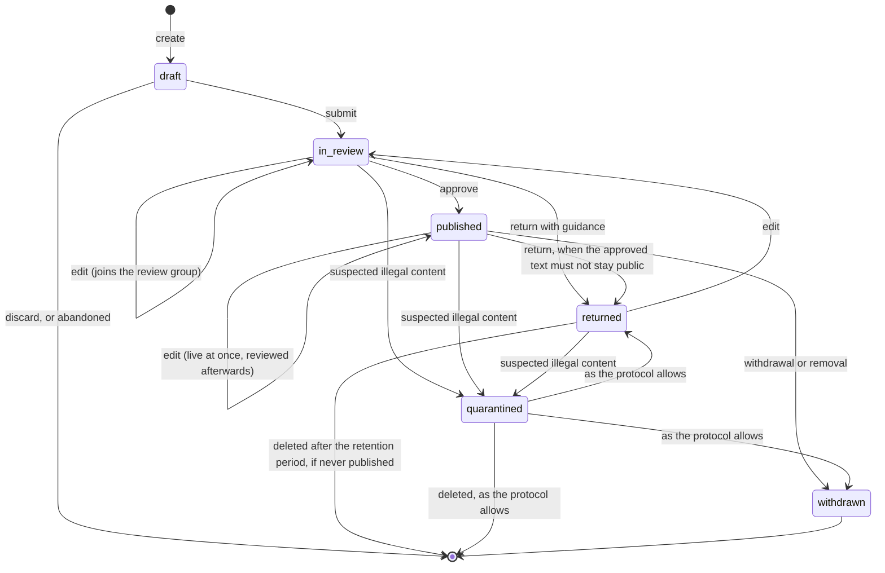

# Data model and testimony lifecycle

Status: Draft (2026-11-15, types, time and constraints added 2026-11-19). Items marked "Proposal" need owner review.

Issue: #14

Basis: plan sections 4 to 12, 22 and 33; the [constitution](../constitution/README.md); [ADR 0003](../decisions/0003-email-magic-link-auth.md), [ADR 0006](../decisions/0006-archive-first-replaceable-application.md), [ADR 0009](../decisions/0009-testimony-licensing.md), [ADR 0010](../decisions/0010-stack-django-postgresql.md), [ADR 0013](../decisions/0013-legal-bases-and-minors.md); [identifiers](identifiers.md); [threat model](threat-model.md); [legal research](../research/legal-landscape.md), sections 2 to 4, 10 and 12.

This model is conceptual. It names objects, fields, types, classifications, constraints and transitions, not database tables. The Django implementation (#21) and the archive format (#13) must both conform to it. Field names are given in `snake_case` because they become identifiers in code and in exports.

## 1. Conventions

### 1.1 Field classification

Every field belongs to exactly one class. The class decides where the field may go.

| Class | Meaning | Rendered publicly | Exported to editions | Example |
| --- | --- | --- | --- | --- |
| `public` | Chosen by the contributor or the project for publication | Yes, when the object is published | Yes | testimony text, display name |
| `private` | About the contributor, needed to run the service, never published | No | Never | account email, text awaiting review |
| `operational` | Needed to run, moderate or secure the service | No | Never | moderation notes, rate-limit counters |
| `evidence` | Kept to show that a legal duty or consent was met | No | Never | consent timestamps and text versions |

Rules:

1. Exports and public views are built from an explicit allow-list of `public` fields. Nothing reaches them by default.
2. A field without a class or a type is a defect. An automated test fails if any model field is unclassified, or if a non-`public` field appears in an export or public template (threat model, section 3.6).
3. Changing a field's class or type is a data-model change and is recorded in this document.

### 1.2 Conceptual types

Every field has one of these types. The type fixes its values, its PostgreSQL representation and its form in editions, so that no type is chosen ad hoc during implementation.

| Type | Values | PostgreSQL | In editions (JSON) |
| --- | --- | --- | --- |
| `id` | Opaque internal identifier, a positive integer | `bigint` identity | Never exported |
| `ref(Object)` | Reference to another object's `id` | `bigint` foreign key | Never exported |
| `public_id` | 8 lowercase Crockford base32 symbols ([identifiers](identifiers.md), section 1.1) | `text`, with a pattern check | String |
| `text(max)` | Unicode text in NFC, line feeds allowed, no other control characters, 1 to `max` code points | `text`, with length and character checks | String |
| `line(max)` | As `text(max)`, but without line feeds and without leading or trailing whitespace | `text`, with checks | String |
| `markdown(max)` | As `text(max)`, interpreted as CommonMark 0.31.2 (section 2.3.1). The stored value is the source text. | `text`, with checks | String, the source text |
| `nat` | Integer, 0 or more | `integer`, with a check | Integer |
| `pos` | Integer, 1 or more | `integer`, with a check | Integer |
| `year` | Gregorian year, 2026 or later | `smallint`, with a check | Integer |
| `bool` | True or false | `boolean` | `true` or `false` |
| `enum(a, b, ...)` | One of the listed codes. Codes are stable, lowercase ASCII with hyphens; labels are localized separately. Used for lifecycle and technical values. | `text`, with an `IN` check | String |
| `enum(Name)` | A value of the named enumeration `Name`, defined once in section 1.5 and reused wherever it appears | `text`, with an `IN` check | String |
| `set(enum)` | A set of codes, without order or duplicates | `text[]`, with checks | Array, sorted, unique items |
| `list(T)` | An ordered list of values of type `T` | `jsonb` or a child table | Array |
| `instant` | A point in time, to the microsecond, in UTC (section 1.3) | `timestamptz` | Never exported |
| `date` | A calendar date in the Gregorian calendar, as a UTC day (section 1.3) | `date` | `YYYY-MM-DD` |
| `email` | An email address, lowercased, validated by the framework's validator | `text`, with a lowercase check | Never exported |
| `url` | An absolute `https` or `http` URL, at most 2,000 characters | `text`, with checks | String |
| `lang` | A BCP 47 language tag in canonical case | `text`, with a pattern check | String |
| `country` | An ISO 3166-1 alpha-2 code, uppercase | `text`, with a pattern check | String |
| `hash` | A keyed hash or digest, as bytes | `bytea` | Lowercase hexadecimal, where exported |

A type followed by `?` is optional: the value may be absent. In PostgreSQL an absent value is `NULL`. In editions it is omitted, never written as `null` (archive format, section 3). A type without `?` is required (`NOT NULL`).

Lengths in `text(max)`, `line(max)` and `markdown(max)` count Unicode code points, not bytes, so that scripts outside ASCII are not penalized. The storage cost of the worst case is bounded anyway: at most 4 bytes per code point, 200 KB for a 50,000-code-point body. A user-perceived character made of several code points (some emoji and combined accents) counts as several.

No field in the model needs a real number. If one ever does, it uses `numeric`, never floating point, so that values survive export and re-import unchanged.

### 1.3 Time

1. Events are stored as instants, never as dates, even where only a date is ever shown. Precision is reduced when data is published or exported, not when it is stored. Instants keep events on the same day in their true order, and give exact times where a dispute or a legal request needs them. The `date` type is kept for calendar concepts that are dates by nature, such as an edition cutoff.
2. Instants are taken from the server's clock, kept synchronized by NTP, and stored in UTC. The database session time zone is UTC.
3. No user time zone is collected or stored. It is not needed to run the service, and it would be one more piece of personal data.
4. A public or exported date derived from an instant, such as the publication date, is the UTC calendar date of that instant. Fields marked "public as a date" are exported under the same name with `_at` replaced by `_on`, for example `published_at` as `published_on`.
5. Public data carries dates, never times of day (threat model, section 3.3). Because a date without a time cannot be converted to another time zone, public pages show the UTC date as is, with "UTC" stated in a tooltip or a note. A testimony published shortly after midnight in Paris therefore carries the previous day's date. The methodology page says so.
6. Private views of the contributor's own account and testimonies show exact instants converted to the browser's time zone, with the UTC value in a tooltip. The conversion happens in the browser and is never sent back.
7. Editions state in their README that every date is a Gregorian calendar date in UTC (archive format, section 2.2).

### 1.4 Constraints

The aim is that invalid states cannot be stored, not merely that the application avoids them.

1. **Within one row:** every rule that relates fields of the same object is a named PostgreSQL `CHECK` constraint, declared in the Django model. The rules are listed under each object below as "Constraints".
2. **Across rows:** uniqueness, "exactly one current revision" and similar rules are unique or partial unique indexes. References are foreign keys.
3. **Across objects, and transitions:** rules that span several objects (for example "a minor's testimony publishes no display name", which joins the consent record) and the permitted state transitions (section 3) are enforced in the domain layer, not by triggers. Triggers would duplicate the domain logic in a second language for little extra safety.
4. Every constraint, at every level, has a test that tries to create the invalid state and expects a failure.

### 1.5 Named enumerations

Descriptive vocabularies, the ones contributors choose from to describe themselves or their testimony, are named enumerations: defined once here, with stable codes and proposed English labels, and referred to by name (owner decision, 2026-11-19). Labels are reviewed and translated in the frontend work (#27); codes do not change once published. Lifecycle values such as states and statuses stay inline `enum(...)` lists on their objects.

Rule for open vocabularies: a vocabulary that describes the world cannot be complete, so it ends with `other`. The field using it has a companion `<field>_note` of type `line(200)?`, an optional free-text comment, independent of the value chosen: a contributor may choose `other` without a note, or any value with one. Vocabularies that are closed by definition (a numeric scale, or categories defined by the constitution) have no `other`, and say why.

| Enumeration | Codes and proposed labels | Open | Used by |
| --- | --- | --- | --- |
| `IdentityMode` | `named` "Under my name"; `pseudonymous` "Under a pseudonym"; `anonymous` "Anonymously" | No: exhaustive by definition | `identity_mode` (2.4) |
| `AgeRange` | `18-24`, `25-34`, `35-44`, `45-54`, `55-64`, `65-74`, `75-plus` "75 and over" | No: a partition of ages (section 2.4.1) | `age_range` (2.4) |
| `OrganizationType` | `none` "No organization"; `self-employed` "Self-employed"; `company` "Company"; `public-sector` "Public sector"; `education` "Education or research"; `non-profit` "Non-profit"; `other` "Other" | Yes | `organization_type` (2.4) |
| `RelationshipToAI` | `user` "I use AI"; `non-user` "I don't use AI"; `refuser` "I refuse to use AI"; `builder` "I build AI"; `researcher` "I study AI"; `affected-by` "I am affected by AI"; `unsure` "Unsure"; `other` "Other" | Yes | `relationship_to_ai` (2.4) |
| `Field` | To be defined in #27; ends with `other` "Other" | Yes | `field` (2.4) |
| `AIUseFrequency` | `never` "Never"; `rarely` "Rarely"; `monthly` "About monthly"; `weekly` "About weekly"; `daily` "Daily"; `constantly` "Constantly"; `unsure` "Unsure" | No: an ordered scale, with `unsure` for the rest | `ai_use_frequency` (2.7) |
| `Attitude` | `enthusiastic` "Enthusiastic"; `positive` "Positive"; `mixed` "Mixed"; `indifferent` "Indifferent"; `negative` "Negative"; `hostile` "Hostile"; `unsure` "Unsure"; `other` "Other" | Yes | `attitude` (2.7) |
| `AuthorshipCategory` | `none`, `assisted-language`, `assisted-structure`, `substantially-generated`, `fully-generated`, `undisclosed`, with the labels of the constitution | No: defined by the [authorship disclosure](../constitution/authorship-disclosure.md) principles, where `undisclosed` covers the rest | `category` (2.6) |
| `TranslationProducer` | `contributor` "The contributor"; `project-human` "A person, for the project"; `machine` "Machine translation" | No: exhaustive by definition | `producer_kind` (2.9) |

## 2. Objects

### 2.1 Account (`private`)

The private identity behind contributions ([privacy assumptions](../constitution/privacy-assumptions.md) 2 and 3).

| Field | Type | Class | Notes |
| --- | --- | --- | --- |
| `internal_id` | `id` | private | Never exposed |
| `email` | `email` | private | Unique. The only contact and withdrawal channel. |
| `email_verified_at` | `instant?` | private | Set by the first successful magic-link sign-in |
| `created_at` | `instant` | private | |
| `last_sign_in_at` | `instant?` | private | |
| `interface_locale` | `enum(en, fr)` | private | For emails; more locales later |
| `status` | `enum(active, restricted, closed)` | operational | |
| `restriction_reason` | `line(200)?` | operational | Publishing rule cited (moderation principles, "Practice" 1) |
| `closed_at` | `instant?` | private | Starts the retention clock (section 6) |

Constraints:

1. `(status = 'closed') = (closed_at IS NOT NULL)`.
2. `(status = 'restricted') = (restriction_reason IS NOT NULL)`.
3. `email_verified_at`, `last_sign_in_at` and `closed_at`, when present, are not earlier than `created_at`.
4. `email` is unique.

No names, photos, phone numbers, postal addresses or identity-provider data are collected.

### 2.2 Sign-in token (`operational`, short-lived)

| Field | Type | Class | Notes |
| --- | --- | --- | --- |
| `token_hash` | `hash` | operational | Hash of a single-use random token. The token itself is never stored. Unique. |
| `email` | `email` | operational | The address it was sent to |
| `created_at` | `instant` | operational | |
| `expires_at` | `instant` | operational | 15 minutes after creation (threat model, section 3.1) |
| `used_at` | `instant?` | operational | |

Constraints: `expires_at > created_at`; `used_at`, when present, lies between `created_at` and `expires_at`.

Deleted once used or expired, after at most 24 hours.

### 2.3 Testimony

The primary object. **One testimony per account** (owner decision, 2026-11-19). A contributor who has more to say edits their testimony (section 2.5) rather than adding another, so the guestbook does not turn into a blogging platform, and the number of testimonies tracks the number of people who took part. Signing in with another address remains possible, so the count is an indicator, not a proof.

| Field | Type | Class | Notes |
| --- | --- | --- | --- |
| `internal_id` | `id` | private | Assigned at draft creation; stable for the object's whole life ([identifiers](identifiers.md), section 1) |
| `public_id` | `public_id?` | public | Assigned at first publication; never reused ([identifiers](identifiers.md), section 1.1). Unique. |
| `account` | `ref(Account)?` | private | Never public, never exported. Unique: one testimony per account. Cleared at withdrawal. |
| `state` | `enum(draft, in_review, published, returned, withdrawn, quarantined)` | operational | See section 3 |
| `language` | `lang?` | public | Of the original text, declared by the contributor. Required from submission. |
| `body` | derived | public | The body of the current revision (section 2.5); not stored on the testimony |
| `received_at` | `instant?` | private | First submission. Decides the edition period (section 5). |
| `published_at` | `instant?` | public as a date | First publication. Published and exported as its UTC date only, to limit correlation with events (threat model, section 3.3). |
| `withdrawn_at` | `instant?` | private | Kept privately to schedule privacy revisions and prune the erase-on-restore list. Never public. |
| `edition_period` | `year?` | public | The cutoff year of the period the testimony belongs to (section 5) |
| `licence` | `enum(CC-BY-4.0)` | public | Stored per testimony so a future change does not rewrite history (ADR 0009) |

Attribution is not a stored string. It is derived from the public identity (section 2.4): `identity_mode` and, for named and pseudonymous testimonies, `display_name`. An anonymous testimony has no attribution value at all, and interfaces and citations render it with the localized label "Anonymous" or "Anonyme". A pseudonymous contributor who calls themselves "Anonymous" therefore stays distinguishable from an anonymous testimony in the data. The rendered attribution string of ADR 0009 is produced from these fields at display and export time.

Constraints:

1. `account` is unique among testimonies that have one.
2. `(public_id IS NULL) = (published_at IS NULL)`.
3. `state IN ('published', 'withdrawn')` implies `public_id IS NOT NULL`.
4. `(state = 'withdrawn') = (withdrawn_at IS NOT NULL)`.
5. `state <> 'draft'` implies `received_at IS NOT NULL`, `language IS NOT NULL` and `edition_period IS NOT NULL`.
6. `edition_period` equals the UTC year of `received_at` (section 5).
7. `state = 'withdrawn'` implies `account IS NULL`.

#### 2.3.1 Text format

The body is CommonMark 0.31.2 source text, of type `markdown(50000)` (owner decision, 2026-11-19). Proposal: the maximum of 50,000 characters stops abuse without constraining a long essay, and is reviewed if real testimonies approach it. The body has at least one non-whitespace character.

1. Only CommonMark is accepted, with no extensions (no tables, footnotes or task lists).
2. Raw HTML is never rendered: the renderer runs with HTML disabled, so any HTML in the source shows as literal text.
3. Images are never rendered. Image syntax is shown as its alternative text, or as a plain link.
4. Links are rendered only for `https` and `http` URLs, with `rel="ugc nofollow noopener"`. Any other scheme is shown as text.
5. Rendering uses a maintained CommonMark library, for example markdown-it-py (4.3.0 on PyPI on 2026-11-19), and the HTML output is passed through an allow-list sanitizer, for example nh3 (0.3.8), as a second barrier. The Content-Security-Policy of the threat model still applies.
6. The editor offers "Write" and "Preview" tabs. Editing opens on "Write"; reading a testimony shows the rendered text. The rendered form looks like the markup, which keeps the interpretability burden close to plain text's.
7. The search vector is built from the rendered text, not from the markup.
8. Headings are rebased when rendered, so that a testimony never repeats the page's `h1`. A heading of level `n` in the source is rendered at level `n + b`, where `b` is the base level configured for the context (for example the testimony page, a listing or an edition's HTML). A level above 6 is rendered as a `div` with `role="heading"` and `aria-level` set to the computed level. The source text is not changed. Styling is decided in the frontend phase.

In editions, the source text is the canonical body. It is valid UTF-8 plain text and readable as such; the HTML rendering is derived (archive format, section 3).

### 2.4 Public identity (all optional)

Every field is optional and published only if the contributor fills it in. Because there is one testimony per account, the identity is in effect the account's public identity, but it is stored with the testimony and never linked publicly to the account. A contributor can change any field by editing; changes to identity fields follow section 2.5 like text changes.

| Field | Type | Class | Notes |
| --- | --- | --- | --- |
| `identity_mode` | `enum(IdentityMode)` | public | |
| `display_name` | `line(100)?` | public | For `named` and `pseudonymous` only |
| `age_range` | `enum(AgeRange)?` | public, with rules | Section 2.4.1 |
| `country` | `country?` | public | |
| `region` | `line(100)?` | public | Shown only if the filter rules allow it (#27) |
| `languages` | `list(lang)?` | public | The languages the contributor lives in, distinct from the testimony's language. No duplicates. |
| `profession` | `line(100)?` | public | |
| `field` | `enum(Field)?` | public | Controlled list for browsing, optional alongside the free-text `profession` |
| `field_note` | `line(200)?` | public | Section 1.5 |
| `organization` | `line(200)?` | public | |
| `organization_type` | `enum(OrganizationType)?` | public | |
| `organization_type_note` | `line(200)?` | public | Section 1.5 |
| `relationship_to_ai` | `set(enum(RelationshipToAI))?` | public | Must not invite sensitive disclosure (legal research, section 3) |
| `relationship_to_ai_note` | `line(200)?` | public | Section 1.5 |
| `link` | `url?` | public | Rendered `rel="ugc nofollow noopener"` (ADR 0003) |

Constraints:

1. `(identity_mode = 'anonymous') = (display_name IS NULL)`.
2. Domain layer, because it joins the consent record: a testimony whose consent record has `declared_age_band = 'under-16'` has `identity_mode` `anonymous` or `pseudonymous`, and no `age_range`, `link`, `organization` or `region` (ADR 0013, D5). A display name that looks like a real name is a moderator check, not a constraint.

#### 2.4.1 Age ranges

Public values: `18-24`, `25-34`, `35-44`, `45-54`, `55-64`, `65-74`, `75-plus`. A minor's testimony shows no age and no age range at all. An "under-18" label would itself mark the contributor as a minor, which makes them a target ([privacy research](../research/privacy-failures.md), R17.2; legal research, section 4). A minor who wants to say they are young can say so in the text. The declared age band used for consent (section 2.8) is a separate field, and is never derived from or into the public value.

### 2.5 Revisions, review groups and the public timeline

A testimony can be edited freely, anywhere in the text: a typo, a sentence in the middle, or a new chapter (owner decision, 2026-11-19). Edits are not limited to addenda. Every edit is just an edit: there is no separate "request changes" step, and any edit opens or joins a review. The public history stays visible as a timeline of dated revisions, but superseded text is not kept once its review is complete, so that a contributor can genuinely remove something, such as personal data added by mistake.

#### Revision

| Field | Type | Class | Notes |
| --- | --- | --- | --- |
| `testimony` | `ref(Testimony)` | operational | |
| `sequence` | `pos` | operational | Order of saving, per testimony |
| `revision_number` | `pos?` | public | Assigned when the revision first becomes public, in order; never reused, because citations name it (identifiers, section 6) |
| `review` | `ref(Review)?` | operational | The review group it belongs to while that group is open |
| `body` | `markdown(50000)?` | public while current, private otherwise | Kept while it is current, or while its review group is open; deleted otherwise (rule 3) |
| `summary` | `line(200)?` | public | Optional "what changed" line written by the contributor |
| `submitted_at` | `instant` | private | |
| `live_at` | `instant?` | public as a date | When the revision became public, if it did |
| `is_current` | `bool` | operational | The revision shown publicly, or the latest text of an unpublished testimony |

Constraints:

1. `(testimony, sequence)` and `(testimony, revision_number)` are unique.
2. At most one revision per testimony has `is_current`, by a partial unique index.
3. `(revision_number IS NULL) = (live_at IS NULL)`.
4. `is_current` implies `body IS NOT NULL`.
5. Domain layer: a `body` is present only on the current revision, on revisions of an open review group, and on the baseline of an open group (rule 3).

#### Review

The unit of moderation is the review group: everything that happened to one testimony since its last completed review, reviewed at once. The moderator never approves micro-edits one by one.

| Field | Type | Class | Notes |
| --- | --- | --- | --- |
| `testimony` | `ref(Testimony)` | operational | |
| `opened_at` | `instant` | operational | At the first submission or first edit after the last completed review |
| `baseline` | `ref(Revision)?` | operational | The last approved revision, kept until the group closes; absent for a first submission |
| `closed_at` | `instant?` | operational | |
| `outcome` | `enum(approved, returned)?` | operational | |

Constraints: at most one open review per testimony, by a partial unique index; `(closed_at IS NULL) = (outcome IS NULL)`.

Rules:

1. Submitting a testimony opens a review group. Edits made before the moderator decides join the same group, so "submit, then fix a typo a minute later" is one review.
2. An edit to a published testimony goes live at once and opens or joins a review group, reviewed afterwards (owner decision, 2026-11-19). Reports are the safety net, and under the DSA a host acts once it knows (illegal-content protocol, section 2). Exception: edits to the testimony of a contributor under 16 are held until reviewed, because the publication restrictions need a moderator; until then the previous revision stays public. There is no edit size limit.
3. While a group is open, the baseline and every revision in the group keep their text. The review interface shows them as a timeline with exact times, and offers both the whole diff from the baseline to the latest revision and the diff between any two consecutive items. Diffs highlight individual changed words, not only lines, in the manner of an editor's side-by-side diff view (exact design in the frontend phase); Python's standard `difflib` computes them. When the group closes, every body in it except the resulting current revision is deleted.
4. Approving a group makes its latest revision current and public. On first approval the testimony gets its `public_id`; each revision that becomes public gets the next `revision_number`.
5. Returning a group sends the testimony back to its contributor with the rule, the reason and guidance on what to change. The latest text stays available to the contributor, who edits it, which opens a new group.
   - For a testimony never published, the testimony becomes `returned` and stays private.
   - For a published testimony whose group contains live edits, the baseline text becomes current again, as a new revision with the next number and the summary "Earlier text restored", so that no revision number is reused. The testimony stays published.
   - For a published testimony whose approved text itself must not stay public, for example personal data reported after approval, the testimony becomes `returned` and is hidden until the contributor edits it.
6. There is no moderator redaction: the moderator never changes a contributor's text. Returning with guidance replaces it, so the public record never carries a permanent "redacted" mark. Returned is an ordinary outcome, and its wording must not suggest a sanction: most returns are about accidents, such as a colleague's name or a phone number, made in good faith.
7. The public page shows a short timeline, folded by default: one line per day, with the date and the summaries of that day's revisions, ordered by `live_at`.
8. An edition keeps the revision that was current at build time. Earlier editions keep the text they captured. A contributor who wants removed text taken out of hosted editions too asks for it, and a privacy revision follows (deletion lifecycle, section 1).
9. Identity and structured fields are edited with the same flow and appear in the timeline as "details updated", without their old values.

### 2.6 Authorship disclosure (`public`)

As defined in [authorship disclosure](../constitution/authorship-disclosure.md).

| Field | Type | Class | Notes |
| --- | --- | --- | --- |
| `category` | `enum(AuthorshipCategory)` | public | Required |
| `model_or_product` | `line(200)?` | public | |
| `model_version` | `line(100)?` | public | |
| `mode_or_setting` | `line(200)?` | public | |
| `workflow` | `text(5000)?` | public | Prompts or workflow description |
| `changes_after` | `text(5000)?` | public | What the person changed afterwards |
| `comment` | `text(2000)?` | public | |

Constraint: `category IN ('none', 'undisclosed')` implies that `model_or_product`, `model_version`, `mode_or_setting` and `workflow` are absent.

### 2.7 Structured testimony fields (`public`, optional)

Proposal: a deliberately short set, to keep the form from feeling like a survey (editorial principles, "Testimonies" 3). The free text remains the testimony.

| Field | Type |
| --- | --- |
| `ai_use_frequency` | `enum(AIUseFrequency)?` |
| `tools_used` | `list(line(100))?` |
| `attitude` | `enum(Attitude)?`, self-described |
| `attitude_note` | `line(200)?` (section 1.5) |
| `prediction` | `text(2000)?`, free text "to leave on record" |
| `prediction_horizon` | `year?` |

Constraint: `prediction_horizon IS NOT NULL` implies `prediction IS NOT NULL`.

Controlled values are the named enumerations of section 1.5.

### 2.8 Consent and age record (`evidence`)

Kept to show that publication was lawful (legal research, sections 2 to 4). One record per submission, and per correction.

| Field | Type | Class | Notes |
| --- | --- | --- | --- |
| `testimony` | `ref(Testimony)` | evidence | |
| `publication_consent_at` | `instant` | evidence | The single publication statement, which is also the explicit consent to sensitive self-disclosure under GDPR art. 9(2)(a) (ADR 0013, D6). One field, so the two consents cannot diverge. |
| `licence_grant_version` | `line(20)` | evidence | Version of the CC BY 4.0 plus project-grant text accepted (ADR 0009) |
| `terms_version`, `privacy_notice_version` | `line(20)` | evidence | Versions shown at submission |
| `consent_locale` | `enum(en, fr)` | evidence | Language of the texts shown |
| `declared_age_band` | `enum(under-16, 16-or-over)` | evidence | Single threshold (ADR 0013, D4). Not the exact age. |
| `consent_path` | `enum(self, parental)` | evidence | |
| `parental_consent_at` | `instant?` | evidence | Parental path only |
| `parental_method` | `enum(email-link)?` | evidence | Parental path only. Verification data itself, such as the parent's email, is deleted once verification completes (CNIL Recommendation 7, legal research section 4). |

Constraints:

1. `(consent_path = 'parental') = (declared_age_band = 'under-16')`.
2. `parental_consent_at IS NOT NULL` implies `consent_path = 'parental'`, and `(parental_consent_at IS NULL) = (parental_method IS NULL)`.
3. Domain layer: a testimony on the parental path cannot be published before `parental_consent_at` is set.

The parental flow and its threshold are decided in [ADR 0013](../decisions/0013-legal-bases-and-minors.md) (#12, #17).

### 2.9 Translation (`public` once published)

As required by the [multilingual principles](../constitution/multilingual-principles.md).

| Field | Type | Class | Notes |
| --- | --- | --- | --- |
| `testimony` | `ref(Testimony)` | operational | |
| `translation_id` | `line(16)`, lowercase letters and digits | public | Unique within the testimony. Several translations per language are allowed, for example machine and human. |
| `language` | `lang` | public | Differs from the testimony's language |
| `body` | `text(100000)` | public | |
| `source_revision` | `pos` | public | Which revision was translated. A translation of an older revision is flagged as possibly outdated. |
| `producer_kind` | `enum(TranslationProducer)` | public | |
| `producer_name` | `line(200)` | public | For machines: system name and version. For people: as they wish to be credited, or "the project". |
| `created_at` | `instant` | public as a date | |
| `reviewed_at` | `instant?` | public as a date | Present if a person reviewed it. Editions also carry a derived `reviewed` boolean for readability. |
| `state` | `enum(draft, published, retracted)` | operational | |

Constraints: `(testimony, translation_id)` is unique; `reviewed_at`, when present, is not earlier than `created_at`.

Only published testimonies may be machine-translated, and only through an EU processor under a DPA or a self-hosted system (threat model, section 3.6).

### 2.10 Moderation record (`operational`)

| Field | Type | Class | Notes |
| --- | --- | --- | --- |
| `testimony` | `ref(Testimony)?` | operational | Cleared at withdrawal unless a legal hold applies (deletion lifecycle, section 3) |
| `review` | `ref(Review)?` | operational | The review group decided (section 2.5) |
| `decision` | `enum(approve, return, remove, quarantine, restrict-account)` | operational | `return` sends the testimony back to its contributor with guidance (section 2.5, rule 5) |
| `guidance` | `text(2000)?` | operational | For `return`: what to change, written for the contributor and sent with the statement of reasons |
| `rule` | `line(50)?` | operational | Identifier of the publishing rule applied (moderation principles, "Practice" 1) |
| `note` | `text(5000)?` | operational | Private moderator note. Must not copy the offending content (#41). |
| `decided_by` | `line(100)` | operational | |
| `decided_at` | `instant` | operational | |
| `statement_sent_at` | `instant?` | operational | Statement of reasons to the contributor (DSA art. 17, legal research section 5) |

Constraints: `decision IN ('return', 'remove', 'restrict-account')` implies `rule IS NOT NULL`; `decision = 'return'` implies `guidance IS NOT NULL`.

### 2.11 Notice (`operational`)

A third-party notice about published content (DSA art. 16, LCEN; #41).

| Field | Type | Class | Notes |
| --- | --- | --- | --- |
| `received_at` | `instant` | operational | |
| `channel` | `enum(form, email, post, authority)` | operational | |
| `testimony_public_id` | `public_id` | operational | |
| `notifier_contact` | `text(1000)?` | operational | Only what the notifier gives and the procedure needs |
| `grounds` | `text(5000)` | operational | |
| `outcome` | `enum(no-action, returned, removed, quarantined, referred)?` | operational | |
| `outcome_at` | `instant?` | operational | |

Constraint: `(outcome IS NULL) = (outcome_at IS NULL)`.

### 2.12 Withdrawal request (`operational`, then minimal `evidence`)

| Field | Type | Class | Notes |
| --- | --- | --- | --- |
| `scope` | `enum(testimony, field, earlier-text, account)` | operational | The testimony; one public-identity field; superseded text still present in hosted editions (section 2.5, rule 8); or the testimony and the account |
| `field_name` | `enum(display_name, age_range, country, region, languages, profession, field, field_note, organization, organization_type, organization_type_note, relationship_to_ai, relationship_to_ai_note, link)?` | operational | For `scope = 'field'` only |
| `testimony` | `ref(Testimony)?` | operational | Cleared when the request completes |
| `requested_at` | `instant` | operational | |
| `verified_at` | `instant?` | operational | Verification by magic link to the account email |
| `steps` | `list(enum(...))` | operational | Propagation checklist ([deletion lifecycle](deletion-lifecycle.md), section 3) |
| `public_id` | `public_id?` | evidence | Kept after completion, with no account link (legal research, section 10) |
| `completed_at` | `instant?` | evidence | |
| `minor_at_collection` | `bool` | evidence | Whether the accelerated erasure right for data collected from minors applied (Loi I&L art. 51 II) |

Constraints:

1. `(scope = 'field') = (field_name IS NOT NULL)`.
2. `requested_at <= verified_at <= completed_at`, where present.
3. `completed_at IS NOT NULL` implies `testimony IS NULL`.

### 2.13 Tombstone (`public`)

What remains publicly of a withdrawn or removed testimony: its `public_id` and the fact that it was withdrawn. It is not a separate object. It is the testimony row in state `withdrawn`, with everything else deleted except the private `withdrawn_at`.

Nothing else is shown or exported: no text, identity, language, country, edition labels, cause or date. Contributor withdrawal and moderation removal look the same publicly, so a tombstone never says "removed for illegal content". The cause stays in the operational records for as long as they are retained. The withdrawal date is not shown either, even coarsened to the month, because no reader or mirror needs it and each published detail narrows who withdrew and when (owner decision, 2026-11-19).

### 2.14 Context document and reference record (`public`, project-authored)

Context documents (plan section 16): `slug` (`line(100)`), `language` (`lang`), `title` (`line(200)`), `body` (Markdown in the repository; ADR 0010 follow-up), `published_on` (`date`), `updated_on` (`date?`), `sources` (`list(text(1000))`). Each language version is a separate document linked by `slug`.

Reference records (plan section 18): `slug`, `name`, `role`, `homepage` (`url`), `resource_url` (`url?`), `description`, `verified_on` (`date`), `local_snapshot` (path and checksum in the edition, if lawful), `licence`, `notes`.

Both are project material, licensed CC BY 4.0 ([ADR 0016](../decisions/0016-project-licensing.md)).

### 2.15 Edition (`public`)

| Field | Type | Class | Notes |
| --- | --- | --- | --- |
| `edition_id` | `line(30)`, pattern `<cutoff-year>.<revision>` or `<year>-rehearsal.<n>` | public | [Identifiers](identifiers.md), section 4. Unique. |
| `cutoff` | `date` | public | Last `received_at` date included |
| `built_at` | `instant` | public as a date | |
| `supersedes` | `line(30)?` | public | The previous revision, if any |
| `state` | `enum(rehearsal, current, superseded)` | public | |
| `manifest_digest` | `hash` | public | Defined by the archive format (#13) |
| `signature` | `text(10000)?` | public | Defined by the archive format (#13) |

Constraint: the UTC date of `built_at` is later than `cutoff`.

### 2.16 Operational records

- **Rate-limit counters:** keyed by account or by a keyed hash of the IP address, with a salt rotated at least daily, so stored keys cannot be reversed into addresses. Retention is the counting window only, at most 24 hours.
- **Derived identifiers:** any value derived from an email or IP address is a keyed HMAC, whose key is held outside the database, never a plain hash. An unkeyed hash of a small input space can be reversed ([privacy research](../research/privacy-failures.md), R14.3).
- **No uploads:** the MVP accepts text only, so there are no images or documents whose metadata (EXIF, GPS, document properties) could identify the contributor. If uploads are ever added, that metadata must be stripped and files re-encoded at intake (R14.4).
- **Admin audit log:** actor, action, object reference and time, append-only (threat model, section 3.2). Never contains testimony text or emails.
- **Sessions:** framework-managed, server-side and revocable.

## 3. Testimony states

Withdrawn is final apart from its tombstone, which is permanent (section 2.13).

| From | To | Who | Effect |
| --- | --- | --- | --- |
| none | `draft` | contributor | `internal_id` assigned |
| `draft` | `in_review` | contributor | Consent record written. `received_at` and `edition_period` are set on first submission only. A review group opens (section 2.5, rule 1). |
| `in_review` | `in_review` | contributor | The edit joins the open review group |
| `in_review` | `published` | moderator | The group is approved. `public_id` and `published_at` set on first publication, the latest revision becomes public, search index and static renderings updated |
| `in_review` | `returned` | moderator | The group is returned with rule, reason and guidance (section 2.5, rule 5). Statement of reasons sent. |
| `returned` | `in_review` | contributor | Any edit opens a new review group |
| `published` | `published` | contributor | An edit goes live at once and opens or joins a review group (section 2.5, rule 2) |
| `published` | `published` | moderator | A group with live edits is returned: the baseline text is restored as a new revision (section 2.5, rule 5) |
| `published` | `returned` | moderator | The approved text must not stay public. The testimony is hidden until edited. |
| `published` | `withdrawn` | contributor | Withdrawal request verified. Deletion lifecycle runs and a tombstone remains. |
| `published` | `withdrawn` | moderator | Removal after a notice or a later finding, for content that editing cannot fix. Same public effect, cause recorded privately. |
| `in_review`, `published`, `returned` | `quarantined` | moderator | Suspected illegal content or a threat, per the [illegal-content protocol](../operations/illegal-content.md). The testimony is hidden everywhere, excluded from exports, search and caches. It is not deleted, and the moderation interface shows its metadata only, never its text, unless the custodian deliberately opens it. A published testimony's URL answers 410, like a withdrawal. |
| `quarantined` | `withdrawn`, `returned` or deleted | moderator | Only as the protocol and the authorities' instructions allow, recorded in the moderation record |
| `draft` | deleted | contributor or system | Discarded by the contributor, or abandoned after the inactivity period. No public ID ever existed. |
| `returned` | deleted | system | Only if never published, after the retention period without an edit |

Invariants (the constraints of section 2.3 enforce the first and third in the database):

1. A testimony has a `public_id` if and only if it has been published at least once.
2. Only `published` testimonies are rendered at their URL. Every other state, including deleted and a returned testimony that was once published, answers the same 404, except withdrawn and quarantined-after-publication, which answer 410 ([identifiers](identifiers.md), section 3).
3. No path leads from `withdrawn` back to `published`. A contributor who changes their mind submits a new testimony, which gets a new `public_id`; the withdrawn one no longer counts against the one-testimony rule because its account link is cleared.
4. A withdrawal request on a `quarantined` testimony is recorded and answered within the deadline, but executed only once the legal hold ends. Erasure can be limited where the data is needed for legal claims or a legal obligation (GDPR art. 17(3); to be confirmed in #41's open items).
5. The consent record of the submission that led to publication is kept while the testimony is published.

## 4. Relationships and linkability

- Account to testimony is private, and one-to-one (section 2.3). No public page, export, URL or identifier reveals the account.
- Public IDs are random and assigned at publication, so publication order does not reveal account grouping.
- Moderators see the account link only where needed: restriction and withdrawal verification.

## 5. Edition periods

Proposal:

1. A testimony belongs to the period of its `received_at` instant: the period whose cutoff is the next 31 December, in UTC. This follows plan section 19, where a submission received after the cutoff "becomes part of a subsequent archival period".
2. An edition is built after the moderation queue for its period has been cleared, for example in the following January. Testimonies received before the cutoff but still unmoderated at build time join the edition's first revision.
3. The edition period is public, because readers and researchers need to know which time capsule a testimony belongs to. It reveals no more than the publication date already does.

## 6. Retention

Retention periods are specified in the [retention schedule](retention.md). This model fixes what each period starts from:

| Object | Clock starts at |
| --- | --- |
| Abandoned draft | Last edit |
| Returned testimony that was never published | Return, if the contributor does not edit it |
| Moderation records | Decision |
| Sign-in tokens | Creation |
| Rate-limit counters | Window start |
| Account | Closure |
| Consent record | Withdrawal or deletion of the testimony |
| Withdrawal evidence | Completion |

## 7. Search

Full-text search uses PostgreSQL per-language configurations: `french` and `english` for those languages, and `simple` for languages without a stemmer (ADR 0010). The search vector is derived in the database from the current public version, so it is updated or deleted with the row (RFP section 8). Only `published` testimonies are indexed.

## 8. Open questions

1. [x] Vocabulary structure: named enumerations with `other` and free text for open vocabularies (section 1.5, 2026-11-19). Still to do in #27: wording and translation review of the labels, the `Field` list, and filter thresholds.
2. [x] Contributors edit their pending submission freely; there is no "request changes" step, and edits join the open review group (section 2.5, 2026-11-19).
3. [x] Moot: there are no moderator redactions (section 2.5, rule 6).
4. [ ] The maximum lengths in section 2 and the structured-field set (section 2.7) are proposals.
5. [x] Moot: there are no redaction notes (section 2.5, rule 6).
6. [ ] Filter thresholds and the allowed filters belong to #27, to be designed later (privacy research, R27.1 to R27.10). For example: no value shown below 10 matches, no age or sensitive-category filters, country-level geography only.
7. [ ] What happens to a once-published testimony that stays `returned` because its contributor never edits it: kept hidden indefinitely, or withdrawn after a period with notice.
